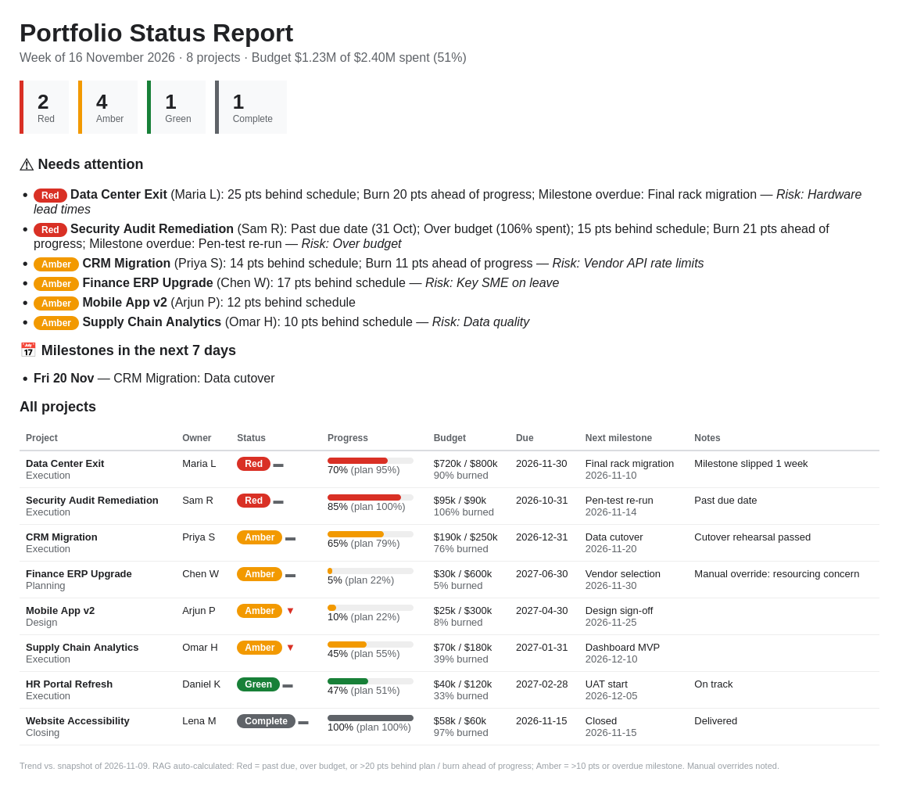
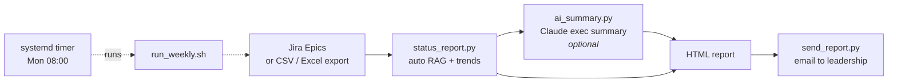

# PMO Portfolio Status Report

[](https://github.com/shivammislankar/pmo-status-report/actions/workflows/tests.yml)

-brightgreen)
[](LICENSE)

**Automated weekly portfolio reporting for a Project Management Office.**
Pulls projects from Jira, scores every project Red / Amber / Green with consistent, transparent rules,
adds an AI-written executive summary, and emails leadership every Monday at 8am, with nobody touching it.


<sub>Sample report generated from the demo data in `data/projects.csv` (fictional projects).</sub>

## Why

Most PMOs build the weekly status deck by hand: chasing PMs for updates, copying numbers into slides, and
accepting each PM's own "Green". This replaces that with:

- **Objective RAG.** Status is calculated from schedule and budget data, so two PMs in the same situation get the same color. Manual overrides are allowed but always disclosed.
- **Trend visibility.** ▲ improved / ▼ worsened / ▬ unchanged vs. last week, so slipping projects surface early.
- **Exception-first layout.** Leadership reads *Needs attention* and *Decisions needed* first, not 40 rows of Green.
- **Zero-touch delivery.** Scheduled run, with a failure alert to the PMO if anything breaks.

## How it works



### RAG rules
"Plan %" is the share of the project's timeline that has elapsed (start → due date).

| Status | Triggered when (worst signal wins) |
|---|---|
| 🔴 **Red** | Past due date · spent > budget · >20 pts behind plan % · budget burn >20 pts ahead of % complete |
| 🟠 **Amber** | >10 pts behind plan % · burn >10 pts ahead of progress · next milestone date passed |
| 🟢 **Green** | None of the above |
| ⚪ **Complete** | 100% complete |

Thresholds are constants at the top of `status_report.py`. A `status_override` column wins, but the report shows the calculated status beside it.

## Quick start (2 minutes, no install)

```bash
git clone https://github.com/shivammislankar/pmo-status-report.git
cd pmo-status-report
python3 status_report.py --demo        # builds two weeks of sample reports with trend arrows
```
Then open `reports/demo/status_2026-11-16.html` in your browser.

**With your own data:** export your tracker to CSV and run `python3 status_report.py -i your_export.csv`.
Common column names (*Project Name, Project Manager, Finish Date, % Complete, Actual Cost…*) are recognized
automatically; add `--dayfirst` for DD/MM/YYYY dates.

## Project structure

| File | Purpose |
|---|---|
| `status_report.py` | CSV → HTML report: RAG scoring, trends, milestones, flexible column/date parsing |
| `jira_pull.py` | Jira Cloud or Server/Data Center → CSV (Epics = projects; progress from child issues) |
| `ai_summary.py` | Optional Claude-written executive summary (structured output, cached, fail-safe) |
| `send_report.py` | SMTP delivery (HTML body + attachment), dry-run preview, failure alerts |
| `run_weekly.sh` | The weekly pipeline: pull → report → email |
| `install_schedule.sh` | Installs a systemd user timer (Mondays 08:00, catches up after sleep/shutdown) |
| `tests/` | Unit tests for RAG rules, parsing, Jira field handling, email, and AI summary rendering |

## Setup for real use

**Your CSV columns:** project, owner, phase, start_date, due_date, pct_complete (0–100), budget, spent,
next_milestone, milestone_date, key_risk, status_override (optional), notes. Only *project*, *due_date*, and
*pct_complete* are required.

### 1. Pull from Jira (no CSV export needed)
Each portfolio project = one **Epic**. % complete = done child issues ÷ all child issues
(or story points); next milestone = earliest unfinished child issue with a due date.

1. `cp jira_config.example.json jira_config.json` and set `base_url`, `email`, and `jql`
   - Jira Server/Data Center: set `"deployment": "server"`, `"child_link": "epic_link"`, and `epic_link_field`
2. Create an API token: https://id.atlassian.com/manage-profile/security/api-tokens
   (Server/DC: Profile → Personal Access Tokens), then `export JIRA_API_TOKEN=...`
3. `python3 jira_pull.py --test` — confirms connection and shows which epics your JQL matches
4. Optional: find custom field IDs for budget, start date, RAG, risk:
   `python3 jira_pull.py --list-fields budget` → put the `customfield_XXXXX` IDs in `fields`
5. Weekly: `./run_weekly.sh` (pulls from Jira, then builds the report)

Unmapped fields are simply left blank; start date falls back to the epic's created date.

### 2. Automatic Monday email
1. `cp email_config.example.json email_config.json` and set SMTP server, `from`, `to`, `cc`
   - Microsoft 365: `smtp.office365.com:587 starttls` (IT may need to enable SMTP AUTH for your mailbox)
   - Gmail: `smtp.gmail.com:587 starttls` with an **app password** (Google Account → Security → App passwords)
2. Store secrets (scheduled runs can't see your shell's `export`s):
   ```
   mkdir -p ~/.config/pmo-status-report
   cat > ~/.config/pmo-status-report/secrets.env <<X
   JIRA_API_TOKEN=...
   SMTP_PASSWORD=...
   X
   chmod 600 ~/.config/pmo-status-report/secrets.env
   ```
3. Preview: `./run_weekly.sh --dry-run` → open `reports/status_<date>.eml` to see exactly what leadership gets
4. First real send — **send to yourself first** (put only your address in `to`), then switch to the real list
5. Schedule: `./install_schedule.sh` (Mondays 08:00; custom: `./install_schedule.sh "Mon 07:30"`)
   - Laptop off/asleep at 08:00? It runs as soon as you next log in.
   - Logs: `journalctl --user -u pmo-report.service` · Remove: `./install_schedule.sh --remove`

If any step fails (Jira down, token expired…), you get a ⚠ FAILED email instead of leadership getting nothing.

### 3. AI executive summary (optional)
Adds a box at the top: one-line headline, 2–3 sentence summary, **decisions needed this week**, and wins —
written by Claude (`claude-opus-5-5`) from the same data the report shows.

1. **Check your company's AI/data policy first** — project names, owners, budgets, and notes are sent to the Anthropic API.
2. Get an API key at https://platform.claude.com → API Keys
3. Add to `~/.config/pmo-status-report/secrets.env`:
   ```
   ANTHROPIC_API_KEY=sk-ant-...
   PMO_AI_SUMMARY=1
   ```
4. Try it: `set -a; source ~/.config/pmo-status-report/secrets.env; set +a; .venv/bin/python status_report.py --ai-summary`

- Cost: roughly a few cents per weekly report.
- Never blocks the report: no key / API down / declined request → report goes out without the box.
- Cached per date in `reports/summary_<date>.json`; re-running on unchanged data doesn't re-bill.
- The SDK lives in `.venv/` (create with `python3 -m venv .venv && .venv/bin/pip install -r requirements.txt`).

## Security & privacy
- Secrets (Jira token, SMTP password, Anthropic key) are read from environment variables or
  `~/.config/pmo-status-report/secrets.env` (outside the repo, `chmod 600`). They never go in config files.
- `jira_config.json`, `email_config.json`, generated reports, and history snapshots are git-ignored.
- All user and AI text is HTML-escaped in the report.
- The AI summary is **off by default**. When on, project data is sent to the Anthropic API.

## Running tests
```bash
python3 -m unittest discover -s tests -v
```

## License
[MIT](LICENSE)
